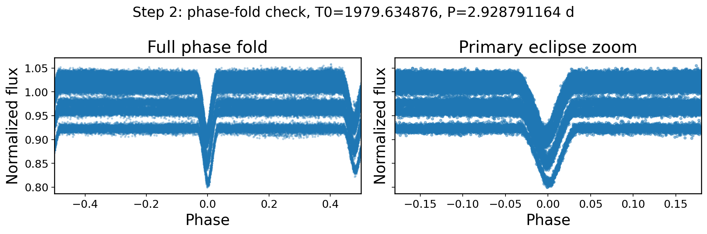

# Eclipse Timing Variation Pipeline for TESS Eclipsing Binary Systems

Computational pipeline for extracting Eclipse Timing Variations (ETVs) from TESS light curves.

---

## Overview

This project develops a computational framework for identifying eclipses, constructing eclipse templates, and measuring Eclipse Timing Variations in eclipsing binary systems observed by NASA's Transiting Exoplanet Survey Satellite (TESS).

The objective is to detect subtle orbital timing changes that may indicate:

- Orbital evolution
- Dynamical interactions
- Third-body perturbations
- Stellar system complexity

---

## Scientific Motivation

Eclipse Timing Variations (ETVs) are powerful probes of orbital dynamics in eclipsing binary systems.

Because observational light curves are often noisy and irregular, robust computational methods are required to accurately identify eclipses and extract timing information.

This project develops a scalable timing-analysis pipeline for TESS observations.

---

## Pipeline Workflow

1. Download and preprocess TESS light curves  
2. Normalize and clean photometric data  
3. Perform phase folding using orbital period estimates  
4. Separate primary and secondary eclipses  
5. Construct eclipse templates  
6. Extract eclipse timing information  
7. Generate timing diagnostics and O–C analysis

---

## Example Outputs

### Normalized TESS Light Curve

### Phase Folded Eclipse Analysis

---

## Example Target

**TIC 275423476**

Key measurements:

- Orbital period ≈ 2.92879 days
- Secondary eclipse phase offset analyzed
- Reduced χ² optimization performed

---

## Technical Stack

- Python
- Lightkurve
- NumPy
- SciPy
- Matplotlib

---

## Future Work

- Automated ETV extraction
- O–C timing diagnostics
- Template-based timing refinement
- Photodynamical modeling

---

## Apsidal-Motion Survey Code (`apsidal_survey/`)

Code from a eclipse-timing search for apsidal motion in TESS eclipsing binaries.
It measures the drift of the secondary eclipse relative to

- **`pipeline/`**: the main pipeline. `apsidal_pipeline.py` finds the period (BLS with
  alias checks), refines the ephemeris, fits every primary and secondary eclipse with
  empirical templates (`local_eclipse_model.py`), and measures the secondary-minus-primary
  drift with diagnostic checks.
- **`crosscheck/`**: validation against an independent eclipse-timing analysis and the
  Prša et al. (2022) TESS EB catalog: period arbitration, re-runs at corrected periods,
  drift comparisons, per-eclipse timing overlays, and summary plots.
- **`kartof/`**: scripts that run on the group server to summarize the independent
  timing measurements.

**Data are not included.** TESS light curves are available from MAST; other inputs
belong to collaborators and are not distributed here.

---

## Author

**Victor Oyiboka**  
Physics Graduate Researcher  
University of Texas at Dallas
